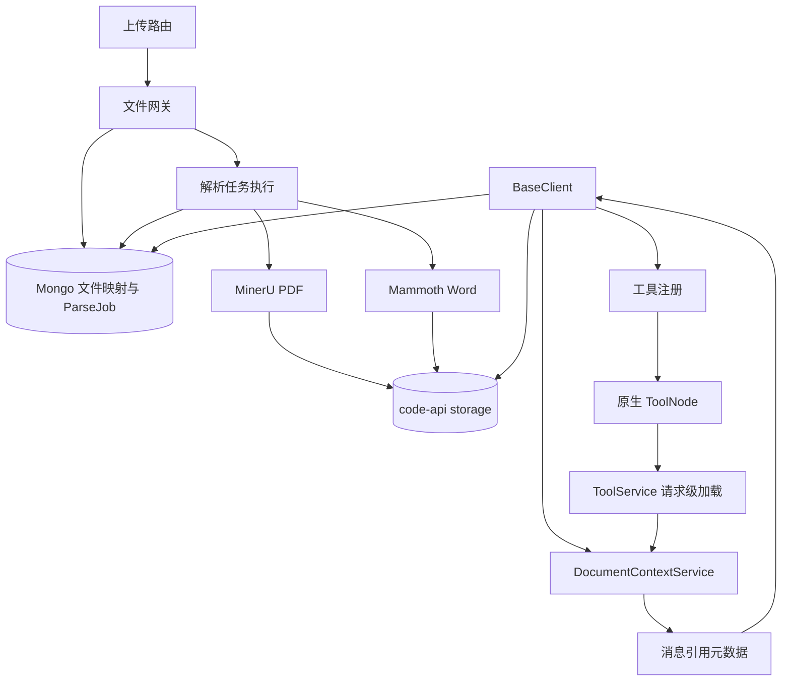

# 三所小智 JIT 文档架构审计（Phase 0）

审计日期：2026-10-31（Asia/Shanghai）。本阶段只读；未修改业务代码、数据库、MinerU、ToolNode 或运行配置。证据快照在 `evidence/jit-phase0-20261031/`。

## 结论

当前系统已经有“上传即持久解析、当前聊天范围过滤、后端自动取回、请求级 PDF/Word 读取工具、跨轮引用元数据”的骨架，但仍是两个聚合工具，不是任务书中的七个细粒度工具。当前 JIT 检索是可解释的字符串关键词选择，不是 BM25、Vector 或 RRF 混合检索。

## 关键组件与职责

| 组件 | 已确认入口 | 职责 |
|---|---|---|
| 上传网关 | `api/server/services/Files/process.js:618-1020` | 三所小智非图片附件强制作为消息附件；写入 LibreChat 文件后建立预解析任务。 |
| Parse Job/文件元数据 | `api/models/sansuoFile.js:3-166,354-460` | `SanSuoFile` 保存源/派生文件和用户、会话、状态；`SanSuoFileParseJob` 以 `userId+libreFileId+parserVersion` 唯一。 |
| 解析执行 | `api/server/services/Files/Code/process.js:76-81,1659-1826` | 领取租约、下载源文件、执行 PDF MinerU 或 DOCX Mammoth、持久化隐藏产物、完成/失败任务。 |
| PDF 产物 | `process.js:887-1034,1064-1285` | MinerU Markdown、chunks JSONL、content list、原始结果、manifest 和图片；content list 稀疏时回退到 Markdown 分块。 |
| Word 产物 | `process.js:511-600,1290-1465` | Mammoth blocks JSONL、reading pack、manifest 和图片；段落、标题样式和表格行列坐标持久化。 |
| 文档读取核心 | `api/server/services/DocumentContextService.js:1-690` | 构造稳定文档/块/章节/表格标识；PDF/Word `list/info/toc/search/read/read_table/read_adjacent`。 |
| JIT 注册 | `api/server/services/Endpoints/agents/sansuoToolPolicy.js:248-424` | 动态注册 `read_parsed_docx`、`read_parsed_pdf`，工具实例限制在本请求已装载的文档集合。 |
| 当前轮取回 | `api/app/clients/BaseClient.js:2290-2515` | 按用户、会话、源文件 ID 和产物类型取回；下载解析产物，构造 DocumentContextService 文档。 |
| 跨轮引用 | `BaseClient.js:4821-4890,3833-3860` | 从当前消息或数据库最近消息读取 `sansuoDocumentReferences`；工具结果 reference 最多保留最近10条。 |
| ToolNode 入口 | `api/server/services/ToolService.js:1257-1410`、`@librechat/agents/dist/cjs/tools/ToolNode.cjs:646` | 请求级 reader 优先加载；纯文档工具调用可提前返回，不准备代码资源；其余工具走统一执行事件。 |
| 运行持久存储 | `sandbox/code-api-server.js:15,80`、`api/models/sansuoFile.js` | code-api 文件位于 `codeapi-data/storage/<storage_session_id>/<file_id>`；Mongo 映射负责会话和源文件关系。 |

## 已核实运行事实

- `LibreChat`、`rag_api`、`vectordb` 当前运行；LibreChat 关键挂载源码与本机哈希一致，详见 `runtime-audit.json`。
- 本机 `http://127.0.0.1:5060/health` 返回 `sansuo-mineru-mock`；容器中的 MinerU 目标分类为本地 mock `/pdf_parse`。mock 使用 `pdftotext`，扫描页返回占位文本，不做真实 OCR（`sandbox/mineru-mock-server.js:20-84`）。
- RAG API 使用 pgvector 配置路径；查询按 `file_id` 向量过滤，权限再检查 metadata `user_id`（RAG 容器 `/app/app/routes/document_routes.py:325-381`）。只读 SQL 检查未观察到 `langchain_pg_embedding` 向量行；这不是对所有未来文件的永久结论。

## 主要边界

- 现有 `DocumentContextService` 的 `document_id` 是 `userId+fileId` 哈希；`parserVersion` 和 `artifactId` 作为字段存在，但没有进入引用 ID 或续读校验。
- `offset/next_offset` 是字符偏移，不是签名 continuation token；服务不验证 token 与文档版本、权限或目标的一致性。
- JIT 服务收到的 `documents` 是请求建立时的 Map；每次工具调用不是重新从数据库解析权限/版本。
- 现有 PDF 章节读取只匹配标题所在 chunk；表格只在单 chunk 内识别，测试已暴露章节和跨块问题（见上轮基线报告）。

## 不应误判

原生 LibreChat RAG 的 `file_search` 是另一条语义向量链；三所小智上传文档 JIT 当前由 `BaseClient` + `DocumentContextService` 负责，两者没有证据表明共享 MinerU chunks 索引。知识库 `SanSuoKnowledge` 又是外部服务链，检索范围独立。

## 关键目录树与依赖图

```text
api/server/routes/files/files.js                 HTTP 上传入口
api/server/services/Files/process.js             文件网关
api/server/services/Files/Code/process.js         解析排队/解析/派生物登记
api/server/services/Files/Code/crud.js            code-api 上传下载策略
api/models/sansuoFile.js                         文件映射、任务、派生物治理
api/app/clients/BaseClient.js                    取回、上下文、文档装载、引用恢复
api/server/services/DocumentContextService.js    PDF/Word records/headings/tables
api/server/services/Endpoints/agents/
  sansuoToolPolicy.js                           工具定义和注册
  initialize.js                                 native event loader/context
api/server/services/ToolService.js               执行时加载请求级 reader
patches/api-server-controllers-agents-client.js  当前挂载的 Agent client
node_modules/@librechat/agents/.../ToolNode.cjs   原生 ToolNode
sandbox/code-api-server.js                      storage 物理持久对象
sandbox/mineru-mock-server.js                   本机 PDF mock
```



`ToolNode` 本身不负责 MinerU 或数据库读取，文档业务逻辑在服务/闭包中；应保留这一边界。当前 graph client 以 `configurable.user_id/thread_id/requestBody` 携带服务端身份/会话，ToolNode 的事件批次带这些配置，initialize 的 loader 再闭包捕获可信 req（`patches/api-server-controllers-agents-client.js:623-638`、`initialize.js:204-275`、`ToolNode.cjs:1850-1858`）。

## 本阶段验证

2026-10-31 新跑：5 个既有套件 272/272，通过；指标/可见证据校验 5/5，通过。前轮 282 个合成用例的逐题结果继续保留，未改样本或预期，未把合成用例混称 Jest 测试。运行 hash 与数据流不等于已验证真实模型端到端。
