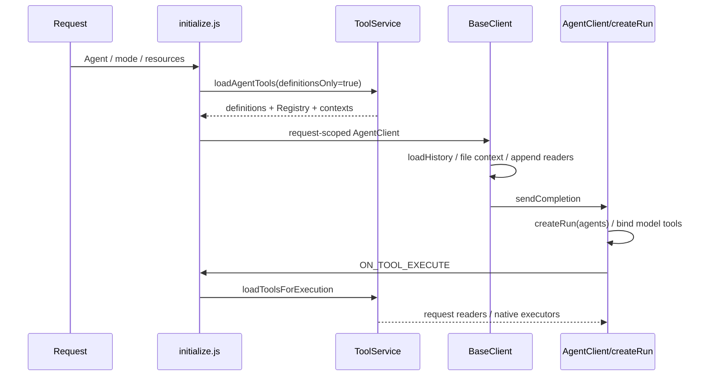

# 当前架构（源码审计）

基线与远端均为 1a9922760f2fb94349b62d2717c36cfa540b892d。2026-11-02 使用显式 SSH ls-remote 核验；没有 origin。工作副本 /tmp/xiaozhi-publish-20261031，依赖目录是指向旧工作区的符号链接。主容器 LibreChat 的 3080 返回 200，但没有部署本次副本。

## 原生时序

Agent 配置持久字段位于 packages/data-schemas/src/schema/agent.ts:43/119（tools/tool_options）。ToolService:909 定义加载、:1257 执行加载；initialize:215 闭包保存各 Agent 上下文，:481/:555/:615 传递 Registry。AgentClient:763 在 BaseClient 附加读取器后 createRun，故“初始化后追加”本身不必然错误；需要确保各 Agent 使用同一请求内 Registry 及绑定的实例。

|工具|定义与注册|暴露|执行与依赖|风险|
|---|---|---|---|---|
|execute_code|sansuoToolPolicy:83/115；原生 CodeExecution 定义|deep 注入，原生能力检查|ToolService/handleTools -> Code API|restrict 会重新插入定义，需核查是否绕过 capability|
|read_parsed_pdf|sansuoToolPolicy:341；BaseClient:4778|Repository 与 sources 就绪|请求实例 -> Repository.executeAsync 或 PageVision.inspect|恢复关键词漏判；无 Registry 时静默不写|
|read_parsed_docx|sansuoToolPolicy:248；BaseClient:4769|Word sources 就绪|请求实例 -> WordContext.execute|尚未发现与 PDF 等价的执行期撤权复核|
|file_search|ToolService/handleTools:404|配置 tools 且 capability|原生 search 文件资源|capability 并不等于当前已启用|
|tool_search|packages/api/src/tools/classification.ts:313|实际存在 deferred tools 且 capability|ToolService:1413 createToolSearch(local)|工具搜索不是 PDF 内容检索|
|MCP/Actions|ToolService 定义及执行路径|Agent 配置、capability、权限、认证|原生 MCP/Action 执行器|本次尚未枚举数据库所有 Agent 的实际配置|

请求级 DynamicStructuredTool 合理；不得把 req、文件、Repository 放进全局契约。定义/schema 当前并列维护，存在漂移风险。真实请求工具集合不能由 yaml capability 列表推出。
