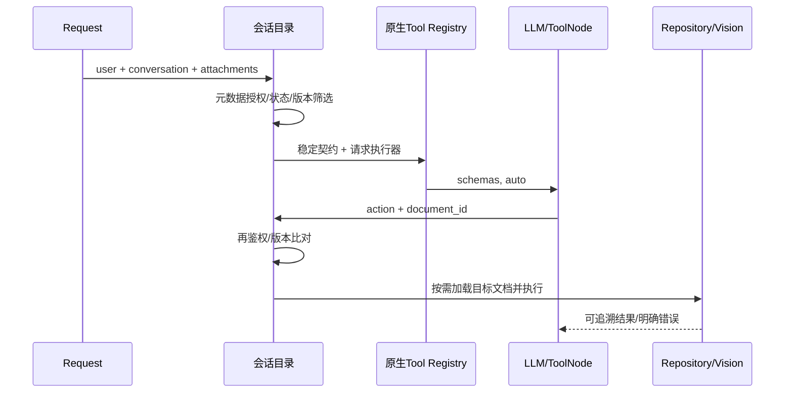
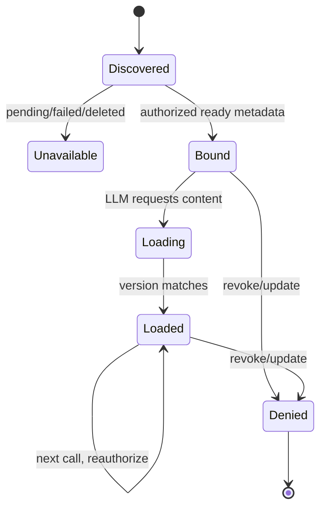

# 方案比较与目标

|维度|A：仅恢复断点|B：会话目录＋按需内容＋原生绑定|
|---|---|---|
|架构/跨轮|去关键词但仍最近消息|所有授权绑定，新增与历史共存|
|一致性|仍由正文成功决定注册|先目录再绑定，运行时明确资源错误|
|安全|延续 PDF 复核，Word 缺口仍在|PDF/Word 统一执行前复核|
|性能|每轮下载检索风险|元数据发现，不调用模型；选中文档才加载|
|测试|局部易测但缺多文件|可注入 db/storage，分别验证各阶段|
|维护/兼容|短期改动少、耦合仍在|复用 ToolService/Registry，不新增框架|
|回归|表面小、隐性 eager 增多|边界变动较大，需固定真实验收|

选择 B。保留原生 Registry 和复合 PDF action，不新建 MCP。新增请求级会话目录模块仅负责授权资源发现/按需加载，不再建工具注册框架。

旧状态为 KeywordMatch -> EagerLoad -> Register，漏判直接跳过 Register。目标引用恢复只作 read_adjacent 的显式上下文，不自动把旧页当新证据。禁止跨请求私有对象缓存；既有 Mongo 向量/词法/视觉缓存保留作用域与版本键。
