# 逐题完整答案对照

所有输出原样保留；评分为AI来源复核，独立人工待审。原图在review-images中，问题/gold错误见protocol-deviations.json。

## longpdf_001

问题：市政协五届二次会议开幕的日期、时间、地点和主持人分别是什么？

物理证据页：[3]

冻结参考答案：2022年1月11日上午8时30分；市行政中心礼堂，疫情防控下设主分会场；曾广斌主持

暂评：部分正确。问题四项均正确且引用p3正确；按冻结gold严格完整性，省略主分会场背景。该额外要求并非问题显式所问，属gold过细风险，单列核心正确。

### 实际回答（原样）

根据文件内容，市政协五届二次会议开幕的具体信息如下：

| 项目 | 内容 |
|------|------|
| **日期** | 2022年1月11日 |
| **时间** | 上午8时30分 |
| **地点** | 市行政中心礼堂 |
| **主持人** | 市政协副主席 曾广斌 |

> 原文依据（第3页）："1月11日上午，市政协五届二次会议在市行政中心礼堂开幕。""上午8时30分，大会在庄严的国歌声中开幕。""大会由市政协副主席曾广斌主持。"

原始工具与日志：[raw/longpdf_001.json](raw/longpdf_001.json)

## longpdf_002

问题：五届二次会议截至提案截止时间，共收到多少提案？个人、联名及集体提案各多少？

物理证据页：[42]

冻结参考答案：1月12日11时截止，共95件；个人31件、联名53件、党派团体11件

暂评：完全正确。95/31/53/11和截止时间正确；未在最终答案注明原页。

### 实际回答（原样）

根据文件内容，截至市政协五届二次会议提案截止时间（1月12日11时），大会共收到提案 **95件**。具体分类如下：

* **个人提案**：31件
* **联名提案**：53件
* **集体（党派团体）提案**：11件

原始工具与日志：[raw/longpdf_002.json](raw/longpdf_002.json)

## longpdf_003

问题：市政协机关党委自2019年成立以来，集中学习、界别党支部和相关制度建设各有哪些数量成果？

物理证据页：[69]

冻结参考答案：集中学习36次；12个界别党支部；6项相关制度

暂评：完全正确。36/12/6准确；额外示意图无新增事实。

### 实际回答（原样）

根据文档内容，自2019年以来，市政协机关党委在这三方面的数量成果如下：

* **集中学习**：开展集体学习 **36次**。
* **界别党支部**：设立 **12个** 界别党支部。
* **相关制度建设**：建立中共党员委员与党外委员联系等 **6个** 相关制度。

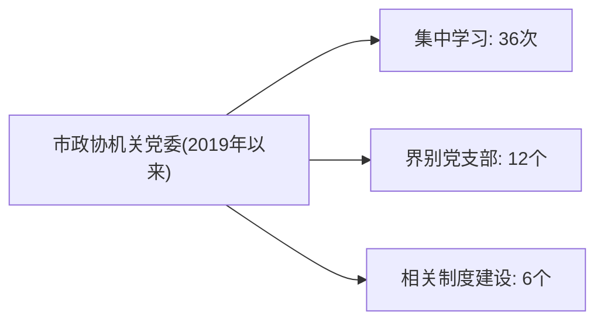
*解释示意图：市政协机关党委党建量化成果概览*

原始工具与日志：[raw/longpdf_003.json](raw/longpdf_003.json)

## longpdf_004

问题：“展风采 铸同心 促共进”书画展在哪里、何时展出？书法与绘画作品各有多少？

物理证据页：[76]

冻结参考答案：市群众艺术馆，6月29日至7月31日；共140幅，其中书法60幅、绘画80幅

暂评：完全正确。地点、展期、140/60/80及首次展览附加事实均有原页支持。

### 实际回答（原样）

根据文件内容，“展风采 铸同心 促共进”主题书画展的相关信息如下：

* **展出地点**：来宾市群众艺术馆
* **展出时间**：6月29日—7月31日
* **作品数量**：共展出140幅作品，其中**书法作品60幅**，**绘画作品80幅**。

（注：该展览是来宾市建市20年来首次以来宾市政协名义举办的书画展。）

原始工具与日志：[raw/longpdf_004.json](raw/longpdf_004.json)

## longpdf_005

问题：比较五届二次会议开幕和闭幕：各在何日，应到和实到委员分别多少，实到人数相差多少？

物理证据页：[3, 7]

冻结参考答案：开幕1月11日，应到313实到271；闭幕1月13日，应到313实到267；闭幕实到比开幕少4人，不推断缺席原因

暂评：完全正确。两次会议各项人数日期与差值正确；最终未标注来源物理页。

### 实际回答（原样）

根据文档内容，五届二次会议开幕与闭幕情况如下：

| 项目 | 开幕 | 闭幕 |
|---|---|---|
| **日期** | 1月11日上午 | 1月13日上午 |
| **应到委员** | 313名 | 313名 |
| **实到委员** | 271名 | 267名 |

**实到人数相差：271 − 267 = 4名**（闭幕比开幕少4人）。

原始工具与日志：[raw/longpdf_005.json](raw/longpdf_005.json)

## longpdf_006

问题：五届一次和五届二次会议提案总数、立案数与立案率有什么变化？不要把办理完成率与立案率混为一谈。

物理证据页：[25, 42]

冻结参考答案：五届一次78件，立案67件，85.9%；五届二次95件，立案82件，86.3%；提案增17件、立案增15件、立案率增0.4个百分点；52.2%是一次提案办理完成率

暂评：部分正确。所问78/67/85.9%、95/82/86.3%和差值正确。附加履职积极性提高、质量优化未获证实；结尾将满意率100%同五届一次办理指标并列，但p25的100%属四届六次，主体归属混淆。

### 实际回答（原样）

根据文档内容，五届一次会议与五届二次会议的提案数据及立案率变化对比如下：

| 会议届次 | 提案总数 | 立案数 | 立案率 |
|:---|:---:|:---:|:---:|
| **五届一次会议** | 78件 | 67件 | 85.9% |
| **五届二次会议** | 95件 | 82件 | 86.3% |
| **变化幅度** | **+17件** | **+15件** | **+0.4个百分点** |

**数据说明：**
* **提案总数**：五届二次会议期间委员履职积极性提高，收到提案总数较五届一次增加 `17件`。
* **立案数**：五届二次会议经审查，将9件内容基本相同的提案合并为4件，另有8件转为意见和建议，最终实际立案 `82件`，较五届一次增加 `15件`。
* **立案率**：从 `85.9%` 微升至 `86.3%`，提升 `0.4个百分点`，整体立案质量与比例保持稳定且略有优化。

> 注：已严格区分**立案率**与**办理完成率（办结率）**。文档中提及的五届一次会议“办结率52.2%”或“满意率100%”属于提案交办后的办理进度与反馈指标，未计入上述立案率统计。

原始工具与日志：[raw/longpdf_006.json](raw/longpdf_006.json)

## longpdf_007

问题：黄焯指出衔接资金项目推进存在什么前期工作问题？结合市政府关于项目前期经费的具体安排，说明其对应关系，并给出当年资金与项目规模。

物理证据页：[34, 13]

冻结参考答案：2021年10.13亿元衔接资金、930个项目；储备不足、前期经费缺乏，资金下达后才办可研用地等手续；市本级每年4000万元，县市区及工业园区每年不少于2000万元；前期经费支持提前谋划和准备，不等于所有问题已解决

暂评：部分正确。问题、4000/不少于2000万元及10.13亿元/930个项目正确。但把经费安排表述为直接填补缺口并提高申报通过率，超出已验证原文；未标作推论，也未给原页引用。

### 实际回答（原样）

根据文档内容，黄焯委员指出的前期工作问题、市政府经费安排及其对应关系如下：

### 1. 前期工作存在的问题
黄焯指出在推进巩固拓展脱贫攻坚成果同乡村振兴有效衔接项目实施中，前期工作主要存在以下短板：
* **项目储备不足**：各级各部门普遍缺乏提前谋划与包装。
* **前期经费配套不到位**：缺乏专项资金支持前期的论证与准备。
* **前期工作被动**：部分县（市、区）和部门没有提前做好可研、用地报批等工作，“资金下达了才开始筹备项目”，导致出现**“政策资金等项目”**的现象。

### 2. 市政府关于项目前期经费的具体安排
为破解上述难题，市政府采取了明确的经费保障措施：
* **市本级**：财政每年落实 **4000万元** 项目前期工作经费。
* **县（市、区）及市工业园区**：督促每年落实项目前期工作经费 **不少于2000万元**。

### 3. 问题与安排的对应关系
市政府的经费安排与黄焯指出的问题形成直接的政策呼应：
* **针对“经费配套不到位”**：通过市本级（4000万）与县市区/园区（≥2000万）的两级财政专项拨款，直接填补前期资金缺口。
* **针对“前期工作被动/资金等项目”**：专项经费的落实使得各部门能够**提前开展项目策划、可研论证和用地报批**，变“资金等项目”为“项目等资金”，从而提升项目储备质量与上级资金申报的通过率。

### 4. 当年资金与项目规模
结合黄焯发言中提及的 **2021年**（实施衔接工作的第一年）数据：
* **衔接资金规模**：获得各级财政衔接资金 **10.13亿元**。
* **项目实施规模**：共实施项目 **930个**。

---

### 解释示意图
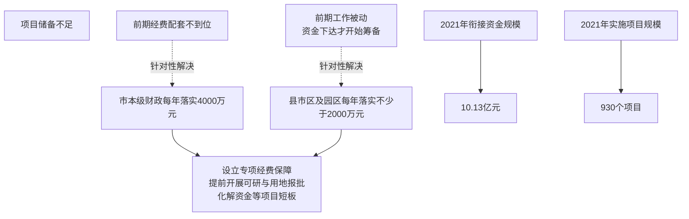

原始工具与日志：[raw/longpdf_007.json](raw/longpdf_007.json)

## longpdf_008

问题：比较九三学社关于农民增收的调研建议和在寨堡屯开展的茶农培训：各自做了什么、覆盖规模多大，为什么不能据此认定农民收入已经增长？

物理证据页：[39, 90]

冻结参考答案：调研148个单位、20个乡镇、20个村委、652份问卷，提出延链增值等建议；莫宇宁为40多位茶农教授种植采摘加工技术；前者政策调研、后者技术服务，文中未给实际增收数据

暂评：部分正确。调研148/20/20/652、培训40余名及内容正确，但遗漏莫宇宁；图中写收入尚未实质性增长，把没有增收证据当作没有增长。

### 实际回答（原样）

根据文档内容，九三学社在“农民增收调研”与“寨堡屯茶农培训”两项工作中定位不同、覆盖范围差异明显。以下从具体行动、覆盖规模及“为何不能认定收入已增长”三个维度进行对比分析：

### 一、 农民增收调研：建言献策与问题诊断
* **做了什么**：承担2021年中共市委“乡村振兴之农民增收渠道”重大课题调研。通过实地走访与问卷，分析农民增收意愿及发展中存在的问题，并向市委提供决策参考。调研指出当地存在“部门未形成合力、产业链条短、生产要素不足”等瓶颈，并建议加快推进粮食甘蔗产业增值、建设农业全产业链、加大工业反哺农业力度、培育健康与非遗产业、利用科技大市场探索“三农”新路子。
* **覆盖规模**：调研了 **148个单位、20个乡镇、20个村民委**，共发放 **652份** 调查问卷。属于市级层面的宏观摸底与政策研究。

### 二、 寨堡屯茶农培训：技能科普与民生服务
* **做了什么**：在长二村寨堡屯“筑牢中华民族共同体意识教育实践基地”揭牌后，邀请企业负责人（九三学社社员）为村民科普茶产业知识，讲解茶苗种植、采摘技术及制作工艺，并现场手把手实操教学。同期配套开展义诊慰问（量血压、测血糖、把脉按摩等）及健康知识科普，免费发放药品与宣传资料。
* **覆盖规模**：茶产业培训覆盖 **40多名茶农**；义诊服务覆盖 **20多名村民**（由12名中瑶医专家提供）。属于定点、小范围的基层赋能与民生关怀活动，且明确规划为“争取用五年的时间”长期助推该屯乡村振兴。

### 三、 为什么不能据此认定农民收入已经增长？
1. **阶段属性不同**：调研属于“诊断与建言”阶段，仅停留在提出对策与揭示问题，尚未转化为实际落地的产业项目或财政支持；培训属于“能力建设”初期，技能传授距离形成规模化产量、打通销售渠道、实现利润变现仍有较长周期。
2. **覆盖规模有限**：培训仅惠及40余名茶农，且寨堡屯活动刚启动（5年规划初期），无法代表区域整体农民群体的收入变化。
3. **结构性瓶颈未破除**：调研已明确指出当地存在“产业链条短、生产要素不足、部门未形成合力”等深层次问题。在产业链未延伸、市场对接未打通、生产要素（资金、技术、物流等）未补齐前，单次技术培训无法跨越“技能→产能→商品→收入”的转化链条。
4. **增收依赖系统工程**：农民经营性收入增长需依赖产业标准化、全产业链建设、工业反哺及大市场对接等系统性改革，非单次科普活动或调研报告可直接兑现。

---

### 解释示意图
以下流程图展示两项工作的定位差异及与“收入增长”之间的逻辑关系：

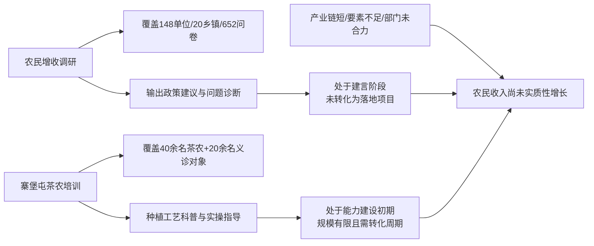

综上，调研提供了增收的“路线图”，培训提供了局部的“技能包”，但两者均处于乡村振兴的**前期铺垫阶段**。在产业链完善、要素注入与市场机制打通之前，不能将调研建议的提出或单次培训的开展直接等同于农民收入的增长。

原始工具与日志：[raw/longpdf_008.json](raw/longpdf_008.json)

## longpdf_009

问题：文化路校园交通整治和象州上平村照明改善，分别如何从读书履职走向群众受益？哪些措施已经落地，哪笔资金仍是计划？

物理证据页：[72, 84]

冻结参考答案：文化路调研协商后设置绕行、限速30公里标志及修改校门口标线，拥堵有所改善；上平村100多盏太阳能路灯已照明，读书基地联系民意推动协调；民宗局下一步将投入30万元，不应当成已支出的路灯款

暂评：无法判定。冻结题把原页上坪村误写为上平村，排除可靠分母。回答遗漏p84已亮100多盏太阳能灯，引用p89其他事件替代；不能将受污染题全部归罪Agent。

### 实际回答（原样）

根据文档内容，两个案例的履职路径与落地情况如下：

## 一、从读书履职到群众受益的路径

两个案例都遵循"**调研发现问题 → 现场协商 → 部门采纳 → 落地见效**"的履职链条：

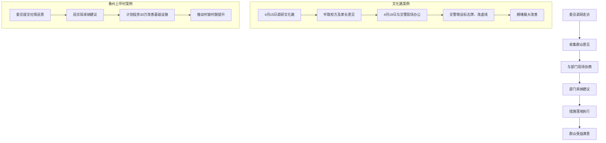

## 二、已落地措施 vs 计划资金

| 案例 | 已落地措施 | 计划/待落实资金 |
|------|-----------|----------------|
| **文化路校园交通整治** | ✅ 交警部门严管； ✅ 路口两端新增"学校密集路段，请车辆合理绕行""限速30km/h"标志牌； ✅ 学校门口交通标识线由实线改为虚线； ✅ 3所学校门口交通安全及拥堵情况**已得到极大改善** | 无（措施已全部落地） |
| **象州上坪村基础设施改善** | 委员建议已被象州县民宗局采纳 | ⏳ **30万元**投资仍为"下一步"计划，用于改造提升村容村貌、促进乡风文明建设 |

## 三、关键细节

- **文化路**：路段约1000米，涉及市第八中学、市民族中学、市民族小学三校，在校师生8000余人。整治后家长和学生均表示满意。
- **上坪村**：系"全国民族团结进步先进集体"，30万元资金由象州县民宗局负责，目前处于计划阶段，尚未拨付落地。

> 注：文档第89页还提及**河里镇街道照明问题**已由镇政府采纳办理并有效解决，属已落地案例。若您所问"象州上平村照明改善"实指此案，则该照明问题已解决；若确指上坪村，则文档中该村30万资金仍为计划，未明确单列照明项目。

原始工具与日志：[raw/longpdf_009.json](raw/longpdf_009.json)

## longpdf_010

问题：象州与金秀分别怎样组织线上线下委员读书？比较其平台构成和活动覆盖数字，并说明这些数字是否都是独立参与人数。

物理证据页：[83, 87]

冻结参考答案：象州4+14+2+1+N：4基地14书屋2渠道1打卡点N活动，102场6万多人次；金秀6+1交流平台，线下6工作室1书屋3书吧；15场2500余人次，线上80多位县委员；人次不等于独立人数，线上委员数与活动人次口径不同

暂评：完全正确。两地平台及102/6万多人次、15/2500余人次/80余名准确，区分人数人次。末尾风格比较属分析推断，不能作为已测量成效；不影响所问数据结论。

### 实际回答（原样）

根据文档内容，象州与金秀在组织政协委员线上线下读书活动的模式、平台构成及覆盖数据上各有侧重。以下为详细对比与说明：

### 📖 象州县政协：阵地驱动与品牌化打卡
**组织方式**
* **线上+线下融合渠道**：以“线上线下”2种结合为渠道，线上开展线上展览、好书推介等；线下依托实体阵地常态化运营。
* **品牌活动**：每周五晚上定期开展“书香象州朗读者”读书打卡行动；联合相关部门开展阅读推广、培训讲座等，打造“书香政协 香飘象州”品牌。

**平台构成**
构建 **“4+14+2+1+N”** 工作新格局：
* `4` 个“书香政协”委员读书实践活动基地（龙头）
* `14` 个“书香政协 委员书屋”（延伸）
* `2` 种线上线下结合渠道
* `1` 个常态化网红“书香打卡点”
* `N` 种形式多样的读书交流活动

**覆盖数字**
* 开展各类活动 **102场次**
* 服务委员和群众开展线上线下阅读 **6万多人次**

---

### 📖 金秀县政协：双线发力与社群化分享
**组织方式**
* **线上发力**：淡化时空限制，开展“好书我阅读”活动。依托政协微信公众号、界别委员活动小组微信群，鼓励委员用短视频、语音、群视频互动分享心得。
* **线下发力**：制定年度工作计划，以 **7项具体工作** 为抓手（推荐书目、建平台、分享活动、“走读广西·阅美大瑶山”系列活动、学习研讨班、调研交流、心得征文）。实体空间免费向群众、学生、旅客开放。

**平台构成**
建立 **“6+1”委员读书交流平台**，并拓展配套书吧：
* `6` 个委员工作室（设于居民小区、同心小剧场、委员企业等地）
* `1` 个委员书屋
* `3` 个飘香书吧、读书角

**覆盖数字**
* 线上互动分享：**80余名** 县政协委员
* 线下/总体活动：2022年以来开展 **15次**
* 总体覆盖：**2500余人次**

---

### 📊 平台与数据对比解释示意图
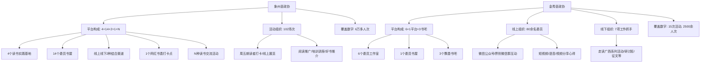

### 🔍 关于“是否为独立参与人数”的说明
**这些数字并不都是独立参与人数（UV）。**
1. **“人次”非独立人数**：象州的 `6万多人次` 与金秀的 `2500余人次` 均明确使用“人次”作为统计单位。在政务与活动统计中，“人次”指累计参与频次，同一人参加多场活动或多次打卡会被重复累加，**不能等同于独立人数**。
2. **明确独立人数的部分**：金秀提到的 `80余名县政协委员` 是针对特定群体（委员）的独立人数统计，表示有80多位不同的委员参与了线上互动分享。
3. **场次与规模的差异**：象州活动场次更多（102场 vs 15次），且覆盖基数更大（6万+ vs 2500+），说明象州更偏向大众化、高频次的社会面推广；金秀则更聚焦委员群体的深度互动与履职转化，数据体量相对精简。

原始工具与日志：[raw/longpdf_010.json](raw/longpdf_010.json)

## longpdf_011

问题：提案工作报告提出如何提高提案质量并加强办理监督？请说明质量要求以及政协与纪检监察协同监督的具体机制。

物理证据页：[28]

冻结参考答案：提案质量、办理质量、服务质量，件件有回音；信息共享抄送制覆盖征集审查督办等环节；政协提案委与纪检监察联合监督领导领办及年度重点提案；重大问题专项通报反馈，属于工作安排

暂评：完全正确。三类质量与抄送、联合督办、专项通报完整，按报告提出要求表述。

### 实际回答（原样）

根据《提案工作报告》相关内容，提高提案质量与加强办理监督的具体要求及协同机制如下：

### 一、 提案质量要求
报告强调“质量是提案工作的生命”，要求从三个维度全面发力：
1. **提案质量**：落实“提案不在多而在精”的要求，严格把控选题、征集、审查、立案、交办等各环节；坚持围绕中心、服务大局，撰写论据充实、建议可行的高质量提案。
2. **办理质量**：作为提案工作的出发点和归宿，强调注重实效，必须做到“件件有回音”。
3. **服务质量**：作为提高提案和办理质量的必要条件，要求组织提案者深入基层调研，切实把问题找准。

**优化选题的具体举措**：
* 开展专题培训，提升新委员履职能力；
* 会前印发《提案选题参考条目》《优秀提案选编》《撰写提案注意事项》等引导材料；
* 召开提案征集会，通过市直相关部门和县（市、区）收集素材，找准影响经济社会发展的关键问题。

### 二、 政协与纪检监察协同监督的具体机制
报告明确提出推进“政协提案办理监督与纪委监督相结合”，并与市纪委机关联合印发《关于贯通运用政协委员履职平台提升监督效能的通知》，重点建立以下**三项机制**：

1. **信息共享机制（抄送制）**：在提案办理各环节实行“抄送制”，确保纪检监察机关实时掌握提案办理的推进进程。
2. **联动监督机制（联合督办）**：针对政协领导领衔督办提案、政协提案委年度重点协商提案，采取政协提案委与纪检监察机关联合督办的方式推进。
3. **情况反馈机制（专项通报）**：对办理过程中的重大情况与重大问题，采取专项通报方式实现信息互通，提升监督的整体性、协同性与实效性。

通过整合政协联系群众广、信息来源多的优势与纪检专责机关监督力度大的优势，推动纪律监督与民主监督协调贯通，形成监督合力。

### 协同监督机制解释示意图

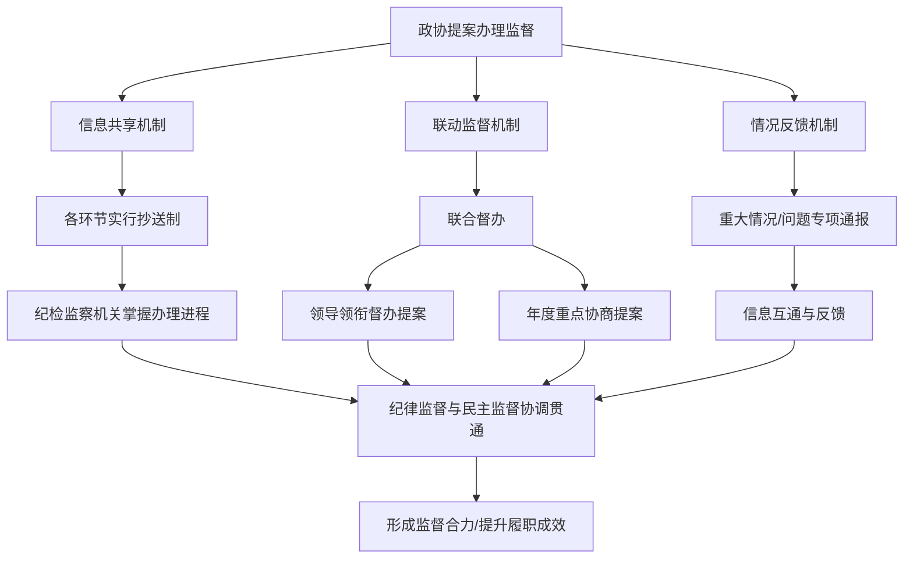

原始工具与日志：[raw/longpdf_011.json](raw/longpdf_011.json)

## longpdf_012

问题：关于农村土地流转的发言，指出了哪些主要障碍，又提出什么对应解决措施？

物理证据页：[36]

冻结参考答案：示范活力不足、经营分散、社会保障不足影响意愿、规模经营风险；政策宣传示范带动帮助算账；权利保障及社会保障，提高积极性；融合发展、规范管理和风险防范

暂评：完全正确。障碍与宣传、保障、风险机制及政府点评完整；三权分立按原文表述，未用常识改写。

### 实际回答（原样）

根据文档中滕佳芸委员关于“规范有序推进土地流转助力乡村振兴”的发言及领导点评，农村土地流转面临的主要障碍与对应的解决措施如下：

### 🚧 主要障碍
1. **意愿与观念阻碍**：农民流转意愿不强，由于缺乏社会保障，农民对失去土地后的生活存在思想顾虑，挫伤了流转积极性。
2. **经营现状制约**：土地分散经营严重影响了土地的有序流转，导致农业规模化经营程度低；同时，流转的示范典型不突出、活力不足。
3. **机制与风险束缚**：土地流转机制不够健全，推进难度较大；此外，农业规模经营本身风险较大，进一步束缚了流转步伐。

### 💡 对应解决措施
1. **宣传引导与典型带动**：
   * 采取多种形式深入宣传农村土地承包经营权流转的政策法律法规。
   * 加强典型宣传，引导农民开展探索性示范试点，用“风向标”的实际收益打动农民。
   * 帮助农民“算好账”，进行流转疏导，切实消除思想顾虑。
2. **制度建设与社会保障**：
   * 加快土地所有权、承包权、收益权“三权分立”进度。
   * 加快完善农村社会保障体系建设，解决农民的后顾之忧。
3. **风险防控与规范管理**：
   * 进一步建立健全土地整合风险防范机制，推动土地流转逐步走上法制化、规范化和程序化轨道。
4. **政府统筹与服务配套**（点评补充）：
   * 积极探索流转模式，加强流转管理服务与用途宏观调控。
   * 建立完善扶持奖励政策，培育壮大农业规模经营主体，大力发展现代特色农业。

### 📊 障碍与措施对应关系（解释示意图）

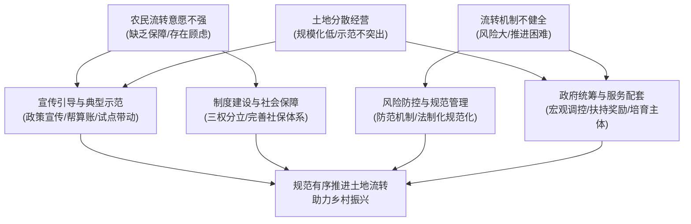

原始工具与日志：[raw/longpdf_012.json](raw/longpdf_012.json)

## longpdf_013

问题：文化路校园交通问题从发现到整改经历了哪些步骤？请区分调研、协商、具体整改和效果观察。

物理证据页：[72]

冻结参考答案：4月15日20多名委员调研约1000米文化路，三校8000多名师生；4月19日委员与交警现场协商；两端设绕行限速30公里标志，校门标线由实改虚；5月家长及现场观察反馈改善，不代表所有校园问题已解决

暂评：部分正确。调研协商整改效果顺序与数字正确；冻结gold要求的5月观察时间未交代。未把结果外推到所有学校。

### 实际回答（原样）

根据文档内容，文化路校园交通问题从发现到整改的完整过程可分为以下四个阶段：

### 1. 调研阶段
* **起因与立项**：市两会期间，市政协收集到“整治校园周边安全隐患”的提案。由九三学社、教育、体育、医药卫生4个界别组成的市政协第三活动小组决定以此为主题开展调研。
* **实地走访**：4月15日，该小组20多名委员到文化路实地调研。发现该路段全长约1000米，双向通行，分布有市第八中学、市民族中学和市民族小学三所学校（在校师生8000余人），且周边住宅小区密集，上下学时段极易拥堵。
* **意见收集**：调研过程中广泛听取了校方及周边群众关于整治校园周边环境的意见建议。

### 2. 协商阶段
* **现场办公**：4月19日，政协委员与交警部门有关人员直接到学校门口进行现场办公。
* **共商对策**：双方针对调研发现的道路交通安全隐患进行面对面协商，探讨解决方案。

### 3. 具体整改阶段
* **强化严管**：交警部门对文化路实施严格管理。
* **设施优化**：
  * 在路口两端新增“学校密集路段，请车辆合理绕行”及“限速30km/h”等交通标志牌。
  * 将学校门口的交通标识线由实线改为虚线，提升通行灵活性。

### 4. 效果观察阶段
* **实地验证**：记者于下午5时许（市第八中学放学）和6时许（市民族小学课后服务结束）分时段走访。观察到学生有序离校，老师与家长在斑马线旁协助指挥，往来车辆与行人按规通行，未发生拥堵现象。
* **群众反馈**：随机采访显示，众多学生和家长对整治成果表示满意。家长代表反馈，此前接送孩子时随意停车、掉头及不礼让行人导致的瘫痪现象已得到极大改善，交通秩序井然。

### 解释示意图
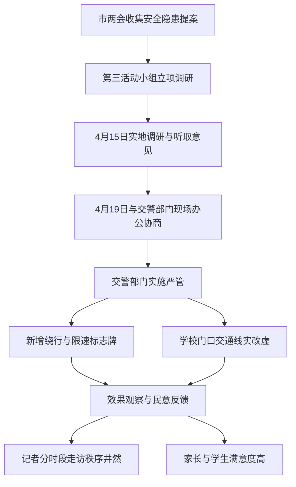

原始工具与日志：[raw/longpdf_013.json](raw/longpdf_013.json)

## longpdf_014

问题：河西街道缤纷社区的“和事佬”与黄繁平委员工作室，服务侧重点有何区别，又有什么共同作用？

物理证据页：[75]

冻结参考答案：6月1日揭牌；和事佬侧重矛盾纠纷调解法律服务；黄繁平提供专业免费法律服务；共同联系群众反映诉求服务民生、搭建履职平台

暂评：部分正确。服务侧重点及共同作用正确；冻结gold的6月1日揭牌时间未提及。问题未显式问日期，属于gold过细导致严格完整性扣分，核心正确另计。

### 实际回答（原样）

根据文档内容，河西街道缤纷社区的“和事佬”与黄繁平委员工作室在服务侧重点上各有分工，但在整体履职与联系群众方面具有高度一致的共同作用。

### 1. 服务侧重点的区别
* **“和事佬”政协委员工作室**：侧重于**基层矛盾调解与纠纷化解**。通过提供法律服务，致力于实现“小事不出社区、大事不出街道、难缠事不上社区”的基层治理目标。
* **黄繁平政协委员工作室**：侧重于**发挥委员法律专业优势**。主要面向群众直接提供免费的、专业化的法律咨询与援助服务。

### 2. 共同作用
两家工作室均为来宾市政协与兴宾区政协联合打造的全市首批政协委员工作室，具有以下共同作用：
* **提升履职与联系群众**：进一步提高政协委员的履职能力，密切委员与群众之间的联系。
* **发挥“连心桥”作用**：更好地充当党政部门与基层群众之间的沟通桥梁。
* **民意汇聚平台**：作为委员了解民情、倾听民意、汇集民智、凝聚共识的新兴平台。

### 解释示意图
以下示意图展示了两家工作室的分工与协同关系：

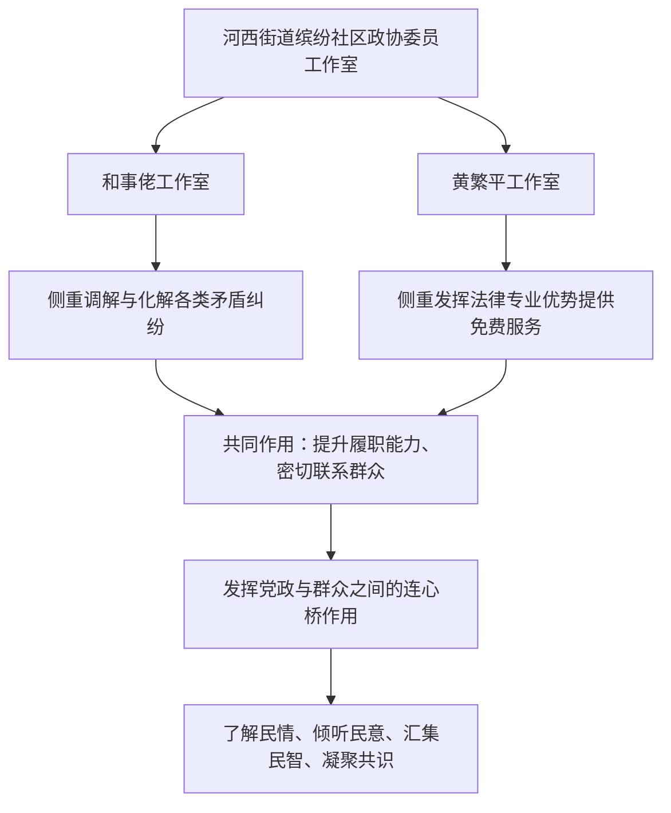

原始工具与日志：[raw/longpdf_014.json](raw/longpdf_014.json)

## longpdf_015

问题：材料里化工园区规划审批与园区申报认定处于什么状态？5—10年指什么，能否理解为园区已经获认定？

物理证据页：[13]

冻结参考答案：总体及产业规划已经专家评审、市政府常务会审议通过；申报认定还需加快推进，不能说已认定；5—10年是建设目标周期

暂评：完全正确。准确区分规划评审、未认定、5至10年未来建设周期。未给页码。

### 实际回答（原样）

根据材料内容，化工园区的规划审批与申报认定状态及“5—10年”的含义如下：

1. **规划审批状态**：园区的总体规划和产业规划**已基本完成审批前期程序**。材料指出，已组织编制《广西来宾绿色化工园区总体发展规划》和《广西来宾绿色化工园区产业发展规划》，目前**已经专家评审，并通过政府常务会审议**。
2. **申报认定状态**：园区**尚未获得认定**，正处于积极准备和推进申报的阶段。材料明确提到“我市尚未认定有化工园区”，下一步工作是“加快申报认定化工园区”以及“加快园区基础设施建设”。
3. **“5—10年”指什么**：指的是**园区建设与目标达成的预期周期**。原文表述为“力争经过5~10年的建设，将三江口医药化工产业园打造成桂中东部化工生产转移的重要承载地和新型生物化工的生产基地，形成新的经济增长极”，即通过5到10年的持续建设来实现该产业定位和经济效益目标。
4. **能否理解为园区已经获认定**：**不能**。材料多处明确指出园区“尚未认定有化工园区”，且当前工作重点仍是“加快申报认定”。5—10年是未来的建设发展期，而非认定后的运营期。

原始工具与日志：[raw/longpdf_015.json](raw/longpdf_015.json)

## longpdf_016

问题：五届一次会议提案中，已办结35件、办结率52.2%的分母是什么？尚在办理多少件？为什么不是用收到的78件作分母？

物理证据页：[25]

冻结参考答案：分母立案67件；尚在办理32件；35/67约52.2%，78是收到总数并非全部立案

暂评：部分正确。35/67及32件准确。但11件未立案提案的转送方式仅称通常，图中又当成该事件确定流程，并称流程均摘自5/18/25页，超出原文证据；满意率分母也不应概括为一律立案数。

### 实际回答（原样）

根据文件内容，为您解答如下：

**1. 办结率 52.2% 的分母是什么？**
分母是**立案数 67 件**。
计算验证：`35 ÷ 67 ≈ 0.52238`，四舍五入即为 **52.2%**。

**2. 尚在办理多少件？**
尚在办理 **32 件**（立案总数 67 件 − 已办结 35 件 = 32 件）。文件中表述为“其余的按规定时间正在办理当中”。

**3. 为什么不是用收到的 78 件作分母？**
因为政协提案有严格的**审查立案程序**。收到的 78 件是提案总数，经审查后只有符合立案条件的 67 件被正式立案并移交承办单位办理（立案率 85.9%）。未立案的 11 件通常作为委员意见建议转送相关部门参考或留存，不进入正式交办与办结统计流程。因此，办结率、满意率等办理质量指标均以**立案数**为统计基数。

---

### 解释示意图

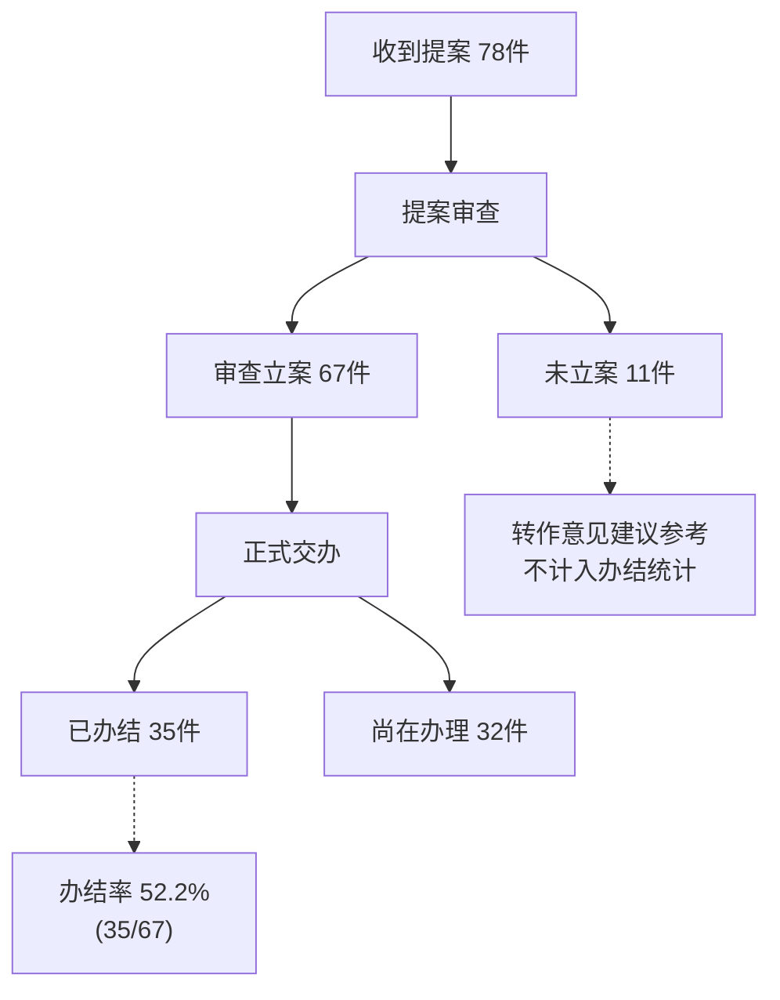

*注：图中数据与流程均摘自文件第5页、第18页及第25页的提案工作报告与办理情况通报。*

原始工具与日志：[raw/longpdf_016.json](raw/longpdf_016.json)

## longpdf_017

问题：迁江华侨农场小学的“六一”慰问中，13名困难学生的助学金和另外两项物资捐助分别多少，合计多少？请区分不同捐赠主体，不要混入六段小学的物资。

物理证据页：[91]

冻结参考答案：希望工程13人各500元，合6500元；市侨联文体用品1000元，中沛光电图书防疫宣传资料2000元；合计9500元，不含另一活动六段小学3000余元

暂评：无法判定。6500/1000/2000/9500和主体正确，原页是防溺水宣传册，冻结gold误记防疫，应排除可靠分母，不惩罚模型正确识别。附注当地唯一另一所小学含混地合并两地事件背景，原文为寨堡屯活动当地唯一一所小学。

### 实际回答（原样）

根据文档第91页的记载，迁江华侨农场小学“六一”慰问活动的各项捐助明细及合计如下（已严格排除六段小学的3000余元慰问品）：

| 捐助项目 | 金额 | 捐赠主体 |
|:---|:---|:---|
| **困难学生助学金** | **6500元**（13人 × 500元/人） | 致公党来宾市委会（引捐团市委“希望工程圆梦行动助学金”） |
| **文体用品** | **1000元** | 市侨联 |
| **爱心图书及防溺水宣传册** | **2000元** | 广西中沛光电科技有限公司 |
| **合计** | **9500元** | 三家单位联合捐助 |

### 解释示意图
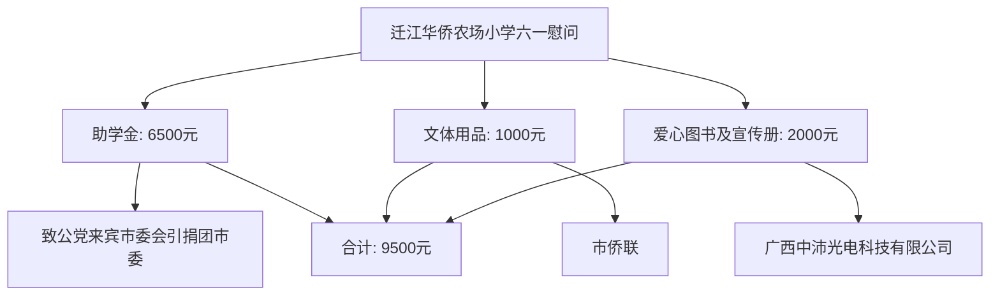
注：六段小学（当地唯一另一所小学）同期收到的3000余元书包、文具等慰问品属于独立慰问活动，未计入上述9500元合计中。

原始工具与日志：[raw/longpdf_017.json](raw/longpdf_017.json)

## longpdf_018

问题：“展风采 铸同心 促共进”书画展每张门票多少钱？请只依据这份材料作答。

物理证据页：[76]

冻结参考答案：材料未给出票价，不能认定收费或免费

暂评：无法判定。正确明确材料未提供所问信息，没有编造票价/名单/增收比例；缺失性gold独立全篇复核待完成，不纳入可靠分母。

### 实际回答（原样）

根据这份材料，文中介绍了“展风采 铸同心 促共进”主题书画展的主办方、承办方、展出时间（6月29日—7月31日）、地点（市群众艺术馆）以及展出作品数量（共140幅，其中书法60幅、绘画80幅）等信息，但**未提及门票价格或任何收费相关内容**。因此，仅依据该材料无法回答每张门票多少钱。

原始工具与日志：[raw/longpdf_018.json](raw/longpdf_018.json)

## longpdf_019

问题：寨堡屯义诊接受诊疗的每位患者分别叫什么名字、确诊什么疾病？材料能否提供完整名单？

物理证据页：[90, 91]

冻结参考答案：材料仅有总体及个别匿名描述，不能提供所有姓名和个体诊断

暂评：无法判定。正确明确材料未提供所问信息，没有编造票价/名单/增收比例；缺失性gold独立全篇复核待完成，不纳入可靠分母。

### 实际回答（原样）

根据提供的材料，关于寨堡屯义诊活动的信息如下：

**活动基本情况：**
- 时间：5月30日
- 地点：来宾市金秀瑶族自治县金秀镇长二村寨堡屯
- 组织方：九三学社广西区委携手九三学社来宾市委
- 医疗团队：12名"名中（瑶）医"专家（来自来宾市中医院、金秀瑶族自治县瑶医医院、金秀镇卫生服务中心）
- 接受诊疗人数：20多名村民

**服务内容：**
- 量血压、测血糖、把脉、按摩
- 分析病情和提出治疗意见
- 指导卫生保健、疾病预防、健康饮食等医学常识
- 免费发放药品、医疗及安全知识宣传资料（价值12000余元）

**关于患者名单和确诊疾病：**
材料中**没有提供**每位患者的具体姓名和确诊疾病的详细信息。仅提到有"20多名村民"接受了诊疗，并引用了一位90岁老人的感谢话语，但未列出任何患者的具体姓名或具体诊断结果。

因此，**该材料无法提供寨堡屯义诊接受诊疗的每位患者的姓名和确诊疾病的完整名单**。这是一篇新闻报道性质的文章，主要记录活动概况和意义，而非医疗记录或患者档案。

原始工具与日志：[raw/longpdf_019.json](raw/longpdf_019.json)

## longpdf_020

问题：九三学社提出用五年助推寨堡屯振兴后，当地每户收入实际提高了百分之多少？

物理证据页：[90, 91]

冻结参考答案：五年助推属于未来计划，材料未给完成后户均实际增收比例

暂评：无法判定。正确明确材料未提供所问信息，没有编造票价/名单/增收比例；缺失性gold独立全篇复核待完成，不纳入可靠分母。

### 实际回答（原样）

根据文档内容，**无法回答当地每户收入实际提高了百分之多少**。

文档第 90-91 页记载的是九三学社来宾市委在金秀县寨堡屯开展科普义诊下乡暨慰问活动的情况。来宾市政协副主席、九三学社来宾市委主委张蕾在活动中表示"**将争取用五年的时间**，充分发挥九三学社人才和组织优势，助推寨堡屯实现乡村振兴，切实提升群众幸福感"。

这是一项**面向未来的计划/表态**，文档仅记录了活动当时的情况（包括茶产业知识科普、义诊慰问、发放价值 12000 余元的药品和宣传资料、到六段小学慰问等），**并未提供五年计划实施后的结果数据**，也没有任何关于"每户收入实际提高百分比"的记载。

原始工具与日志：[raw/longpdf_020.json](raw/longpdf_020.json)

## turn_01

问题：请从材料中找出文化路校园交通整治这件事，说明谁推动、主要解决什么问题。

物理证据页：[72]

冻结参考答案：第三委员活动小组，九三学社教育体育医药卫生界；三校周边上下学拥堵安全

暂评：完全正确。主体、四界别、交通问题准确；首次无历史引用。

### 实际回答（原样）

根据材料内容，关于“文化路校园交通整治”的相关信息如下：

**🔹 谁推动的**
主要由**市政协第三活动小组**（由九三学社、教育、体育、医药卫生4个界别组成）推动。该小组结合委员读书实践活动开展专题调研，并由小组联络员李宏福等委员牵头，联合**交警部门**共同现场办公与协商落实。

**🔹 主要解决什么问题**
核心解决**市城区校园周边交通安全隐患及上下学时段道路拥堵问题**。具体痛点包括：
1. **路段压力大**：文化路全长约1000米，分布有市第八中学、市民族中学和市民族小学3所学校，在校师生超8000人，且周边住宅小区密集。
2. **交通秩序混乱**：上下学时段部分家长随意停车、掉头，以及过往车辆经过斑马线不礼让行人，极易造成道路拥堵甚至瘫痪。
3. **安全隐患突出**：师生密集通行与机动车混行存在较大道路交通安全风险。

---

### 📊 整治推动流程（解释示意图）
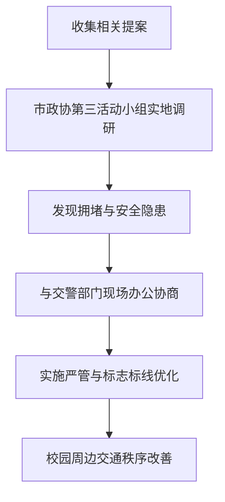

**💡 补充成效**：经协商整治，交警部门在路口两端新增“学校密集路段，请车辆合理绕行”及“限速30km/h”等提示牌，并将学校门口交通标识线由实线改为虚线，3所学校门口的交通安全及拥堵情况得到极大改善。

原始工具与日志：[raw/turn_01.json](raw/turn_01.json)

## turn_02

问题：刚才那项整治具体改了哪些交通设施，限速是多少？

物理证据页：[72]

冻结参考答案：绕行、限速30公里标志；校门口实线改虚线

暂评：完全正确。自然指代恢复正确，30km/h和标线改动一致。

### 实际回答（原样）

根据材料内容，文化路校园交通整治具体改动的交通设施及限速如下：

**🔹 具体改动的交通设施**
1. **新增标志牌**：在路口两端新增了“学校密集路段，请车辆合理绕行”提示牌以及限速标志牌。
2. **优化交通标识线**：将学校门口的交通标识线由**实线改为虚线**，以规范车辆通行。

**🔹 限速数值**
该路段的限速设置为 **30km/h**。

---

### 📊 设施整改内容（解释示意图）
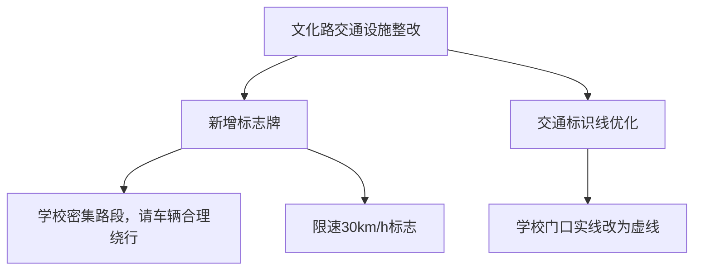

原始工具与日志：[raw/turn_02.json](raw/turn_02.json)

## turn_03

问题：请给上一轮这些整改措施的原文依据和出处，别只重复结论。

物理证据页：[72]

冻结参考答案：引用绕行限速30公里及实改虚原文；出处支持相应交通措施

暂评：未完成。要求原文依据后模型流持续120秒超时，619499字节已传输，未形成答案。真实非注入；stream_started抑制重试。

### 实际回答（原样）

本次回答未完成：模型请求超时（MODEL_TIMEOUT）。已取得的证据不能视为完成核对的答案；请稍后重试。

原始工具与日志：[raw/turn_03.json](raw/turn_03.json)

## turn_04

问题：材料中象州上平村也有一件通过委员读书履职改善生活的事，具体是什么？

物理证据页：[84]

冻结参考答案：100多盏太阳能路灯亮起；中平社区委员读书基地协调群众诉求

暂评：无法判定。受上平/上坪拼写缺陷影响，排除可靠分母。自然检索后正确取得100多盏灯；正文将投资30万元仍未来，但图和促进效果表述失去未来限定。

### 实际回答（原样）

根据材料内容，象州上平村通过委员读书履职改善生活的具体事项如下：

**🔹 推动主体**
象州县政协在中平社区创建了委员读书实践活动基地，搭建起了委员与群众交流、了解社情民意的桥梁，推动民生问题的解决。

**🔹 主要改善内容**
1. **安装太阳能路灯**：上坪村安装了100多盏造型美观的太阳能路灯，沿着平坦宽阔的水泥路向村庄深处延伸，解决了夜间照明问题。
2. **基础设施改造**：象州县民宗局将投资30万元用于改善上坪村的基础设施，改造提升村容村貌。
3. **促进乡风文明与民族团结**：通过这些举措，促进了乡风文明建设，推动了民族团结事业的发展。

---

### 📊 委员读书履职改善民生流程（解释示意图）
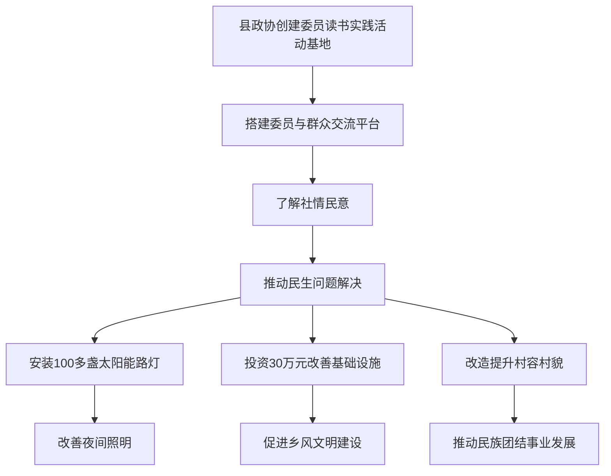

原始工具与日志：[raw/turn_04.json](raw/turn_04.json)

## turn_05

问题：比较刚才这两个事件，哪些是已落实的措施，哪些还只是下一步资金计划？

物理证据页：[72, 84]

冻结参考答案：交通标志标线及100多盏灯已落地；民宗局30万元为下一步计划

暂评：无法判定。受先前地名缺陷影响，可靠分母排除。正确区分100多盏灯已亮和30万元未来计划，但把原文既有平坦水泥路写成此次已修建措施；这是追加未经证明的因果归属。

### 实际回答（原样）

根据材料内容，这两个事件在**落地进度与资金规划**上存在明显差异。具体对比如下：

### 🔍 详细对比

| 事件 | ✅ 已落实的措施 | 💰 下一步资金/计划 |
|:---|:---|:---|
| **文化路校园交通整治** | 1. 路口两端新增“学校密集路段，请车辆合理绕行”提示牌 2. 新增限速标志牌（限速30km/h） 3. 学校门口交通标识线由**实线改为虚线** *(原文表述：“经协商整治…得到极大改善”)* | **无**。该事项已通过交警部门现场办公协商完毕并实施，材料中未提及后续资金投入或扩建计划。 |
| **象州上坪村（上平村）改善** | 1. 安装**100多盏**太阳能路灯，解决夜间照明 2. 修建平坦宽阔的水泥路 3. 县政协在中平社区创建委员读书实践活动基地 *(原文表述：“路灯准时亮了起来…搭建起了委员与群众交流的桥梁”)* | **有**。象州县民宗局计划下一步**投资30万元**，用于进一步改善该村基础设施、改造提升村容村貌、促进乡风文明与民族团结。 |

---

### 📊 状态对比解释示意图
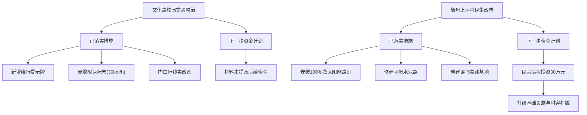

### 💡 核心结论
- **文化路交通整治**属于**“协商即落地”**型事项，所有提及的交通设施改造均已实施完毕，目前处于成效巩固阶段。
- **象州上坪村改善**属于**“分步推进”**型事项，基础照明与道路已解决，但涉及村容村貌整体提升的**30万元专项资金**仍处于“下一步计划”阶段，尚未完全拨付或施工。

原始工具与日志：[raw/turn_05.json](raw/turn_05.json)

## turn_06

问题：把象州的读书平台组织方式与上平村的这个事联系起来，说明平台怎样转化为履职，给出平台构成。

物理证据页：[83, 84]

冻结参考答案：4+14+2+1+N及组成；阅读交流发现诉求协调照明改善

暂评：无法判定。四基地与读书联系民意正确，但未覆盖冻结gold要求的完整4+14+2+1+N。未新调用工具，使用已有材料。地名缺陷下单列探索结果。

### 实际回答（原样）

根据材料内容，象州县的读书平台组织方式与上坪村的民生改善紧密相连，具体联系、转化机制及平台构成如下：

### 🔹 平台构成
象州县政协投入60多万元，创建了**4个市县政协联动的委员读书实践活动基地**，分别服务不同对象：
1. **“书香政协·茶韵妙皇”**（妙皇乡思高村）
2. **“书香政协·古韵罗秀”**（罗秀镇纳禄村）
3. **“书香政协·魅力中平”**（中平镇中平社区）—— **上坪村即依托此基地**
4. **“书香政协·法护企业”**（石龙工业园区）

### 🔹 平台与上坪村的联系
上坪村（全国民族团结进步先进集体）属于中平镇，其民生改善直接得益于**“书香政协·魅力中平”**这一读书实践活动基地的辐射与带动。该基地搭建起了委员与群众交流的桥梁，使上坪村成为“读书+履职”深度融合的受益点。

### 🔹 平台如何转化为履职
平台并非单纯的阅读场所，而是通过以下机制将“读书”转化为“履职”：
1. **搭建桥梁，收集民意**：读书活动的常态化开展，让委员有机会与群众面对面交流，从而深入了解社情民意（如上坪村的照明和基建需求）。
2. **深度融合，赋能履职**：将读书实践与**推动产业发展、助力乡村振兴、铸牢中华民族共同体意识**有机结合，把读书所得转化为履职本领和工作成果。
3. **推动落实，解决问题**：通过了解到的民意，委员积极建言献策，推动了上坪村**100多盏太阳能路灯的安装**以及**下一步30万元基础设施改造资金**的落实。

---

### 📊 平台构成与履职转化解释示意图
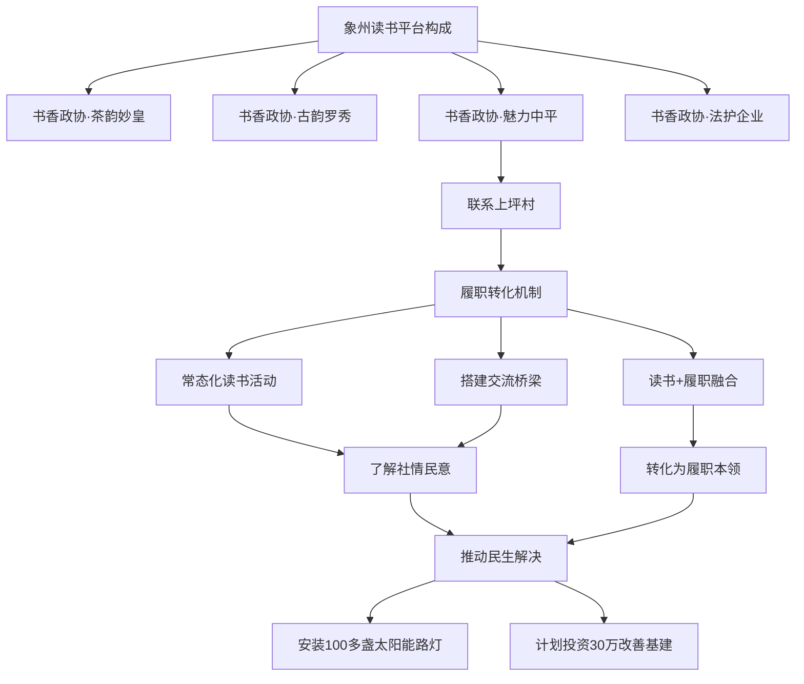

原始工具与日志：[raw/turn_06.json](raw/turn_06.json)

## turn_07

问题：换个关注点，金秀如何开展线上线下读书？活动规模有哪些数据？

物理证据页：[87]

冻结参考答案：6+1平台，6工作室1书屋3书吧；15场2500余人次，线上80多位委员

暂评：完全正确。最终数据及平台准确，但3次read_parsed_pdf不存在，sandbox直读PDF被拒；4次execute_code中最终读取既有MinerU Markdown恢复，耗时156.87秒，不能标工具链全成功。

### 实际回答（原样）

根据材料中《金秀瑶族自治县政协：“双线发力”推动履职和读书活动双促进》一文，金秀县政协通过**“线下线上”相融合**的方式开展读书活动，具体组织方式、平台构成及规模数据如下：

### 🔹 1. 开展方式与平台构成

**📉 线下发力（促习惯）**
*   **平台构成（“6+1”体系）：** 在居民小区、“同心小剧场”、委员企业等地，共设置**6个委员工作室**、**1个委员书屋**、**3个飘香书吧**。这些场所免费向群众、学生、旅客开放，作为读书交流的固定阵地。
*   **组织方式：** 制定《2022年工作计划》，以**7项具体工作**为抓手（推荐书目、读书分享、“走读广西”系列活动、研讨班、调研交流、征文等）。县政协领导班子成员带头联系读书小组并分享心得，发挥示范作用。

**📈 线上发力（融日常）**
*   **平台构成：** 依托**政协微信公众号**、**界别委员活动小组微信群**等数字化渠道。
*   **组织方式：** 开展线上“好书我阅读”活动，打破时空限制，鼓励委员使用**短视频、微信语音、微信群视频**等多媒体形式进行互动分享，将读书融入日常工作生活。

---

### 🔹 2. 活动规模数据

| 维度 | 具体数据指标 |
|:---|:---|
| **线下活动规模** | 2022年以来共开展读书活动 **15次**，参与人数达 **2500余人次**。 |
| **线上参与规模** | 读书实践活动开展以来，共有 **80余名** 县政协委员通过线上渠道进行互动分享。 |
| **平台设施数量** | 建成 **6个** 委员工作室、**1个** 委员书屋、**3个** 飘香书吧。 |

---

### 📊 “双线发力”组织与规模解释示意图
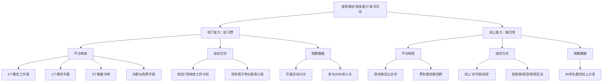

原始工具与日志：[raw/turn_07.json](raw/turn_07.json)

## turn_08

问题：据刚才这些数字，能否断言金秀有2500多名不同委员参加，而且全部80多名线上委员都参加了线下活动？为什么？

物理证据页：[87]

冻结参考答案：不能，人次不等于人数；线上与线下不能推定同一集合

暂评：部分正确。正确区分人次与人数，不能推断线上线下交集。但补充县级政协通常两三百人、不可能2500名，用外部常识代替本材料证据，且忽略活动向群众开放。

### 实际回答（原样）

**不能断言。** 根据材料中的表述，这两个推论均不成立，原因如下：

1.  **关于“2500多名不同委员”：**
    *   **原文表述为“人次”而非“人数”。** 材料原文是“开展委员读书活动15次，参与人数**2500余人次**”。“人次”是累计概念，意味着同一位委员可能多次参加不同场次活动，数据是累加的。
    *   **常识逻辑不符。** 县级政协委员的总人数通常在两三百人左右，不可能有2500多名“不同”的委员。因此，2500多指的是参与的总次数，而非不重复的个体数量。

2.  **关于“全部80多名线上委员都参加了线下活动”：**
    *   **数据相互独立。** 材料中线下数据（2500余人次）和线上数据（80余名委员分享）是**分别统计**的，文中并未提及这两个群体的交集或包含关系。
    *   **缺乏证据支持。** 没有任何信息表明这80多名进行线上分享的委员“全部”或“部分”参与了线下活动。他们可能只参与了线上分享，也可能同时参与了线下活动，但无法从现有数据中得出“全部参加”的结论。

原始工具与日志：[raw/turn_08.json](raw/turn_08.json)

## turn_09

问题：文化路这次整改安装交通标志实际花了多少钱？材料能确定吗？

物理证据页：[72]

冻结参考答案：材料未给实际费用，不能把别处30万元套用

暂评：无法判定。正确拒答标志费用；补充的滨江小学200万元及p77引用已在运行后原图复核正确。缺失性gold仍待全篇独立核验，排除正式分母。

### 实际回答（原样）

**不能确定。** 材料中**未提及**文化路交通整改安装标志牌的具体花费金额。

材料中关于该事件的描述仅涉及以下方面：
1. **具体措施**：交警部门在路口两端新增“学校密集路段，请车辆合理绕行”及“限速30km/h”标志牌，并将学校门口交通标识线由实线改为虚线。
2. **协商过程**：政协委员与交警部门现场办公协商解决。
3. **成效**：拥堵和安全隐患得到极大改善。

**⚠️ 注意区分混淆信息**
材料中确实出现过一笔 **200万元** 的资金记录（第77页），但那是市财政局拨款用于**滨江小学道路修建**的款项，与文化路安装交通标志的整改无关。

原始工具与日志：[raw/turn_09.json](raw/turn_09.json)

## turn_10

问题：回到最初的交通问题：30万元是不是用于文化路交通标志的已支出费用？请纠正可能的混淆并重述限速及相关依据。

物理证据页：[72, 84]

冻结参考答案：不是，30万元是上平村基础设施未来计划；文化路限速30公里，引用不同来源不可混淆

暂评：无法判定。正确区分30万元未来村庄计划与文化路限速30km/h；但沿用上轮200万元后声称材料唯一较大金额，明显与4000万元等相矛盾，跨轮扩张错误。受地名缺陷另列。

### 实际回答（原样）

**不能确定，且存在事实混淆。** 30万元**绝对不是**用于文化路交通标志的费用，而是属于另一个完全不同的民生项目。

### 🔹 纠正混淆与资金归属
1.  **30万元的真实用途**：这笔钱是**象州县民宗局**计划**下一步**拨付给**象州上坪村**的，用于改善该村的基础设施、改造村容村貌及促进乡风文明。它属于“未来计划”，而非文化路的“已支出”。
2.  **文化路整改花费**：材料中**完全没有提及**文化路安装标志牌和划线具体花了多少钱。
3.  **易混淆点提示**：材料中唯一出现的较大金额是市财政局拨款的**200万元**，但那是用于**滨江小学道路修建**，同样与文化路无关。

### 🔹 重述限速及相关依据
*   **限速数值**：**30km/h**。
*   **原文依据**：根据材料记载，经过政协委员与交警部门现场办公协商，交警部门对文化路进行严管，具体措施包括“在路口两端新增‘学校密集路段，请车辆合理绕行’、**‘限速30km/h’**等标志牌”。

---

### 📊 资金与措施归属解释示意图
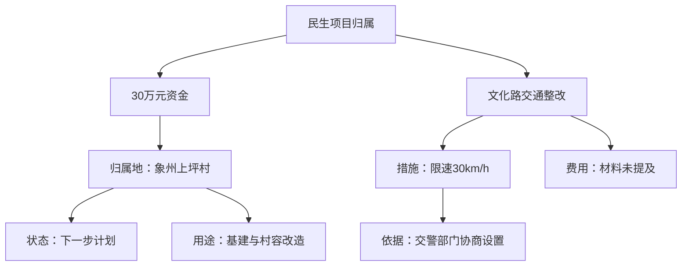

原始工具与日志：[raw/turn_10.json](raw/turn_10.json)

